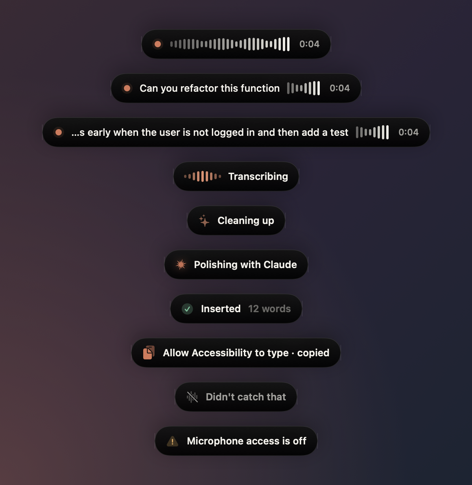
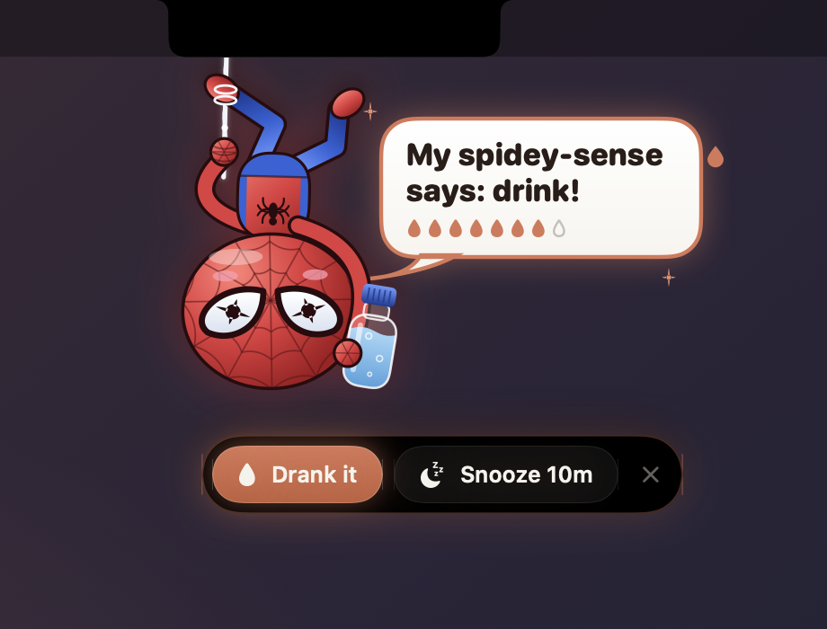
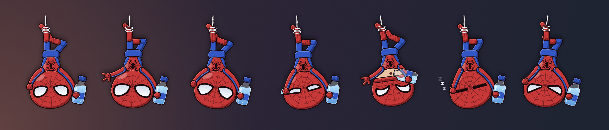
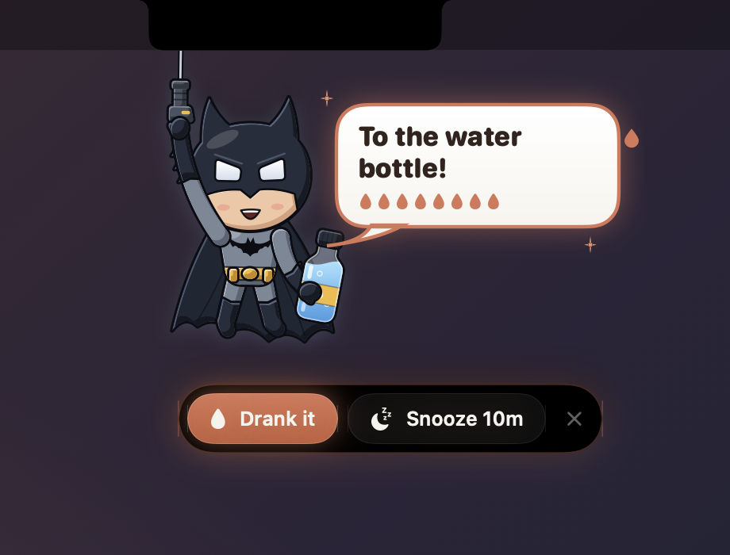
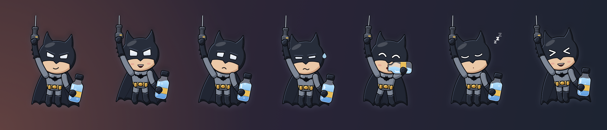
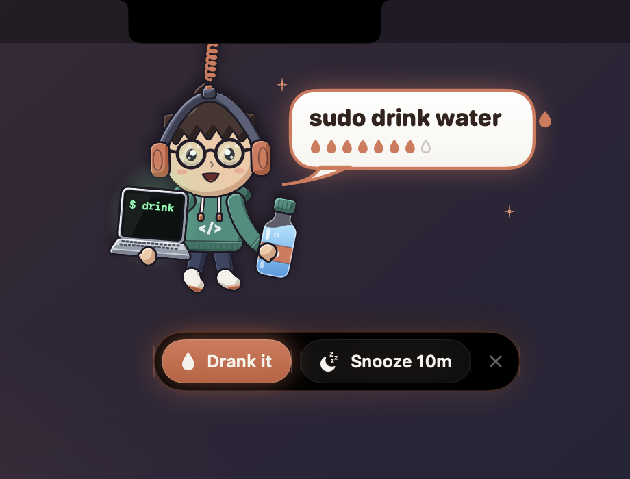
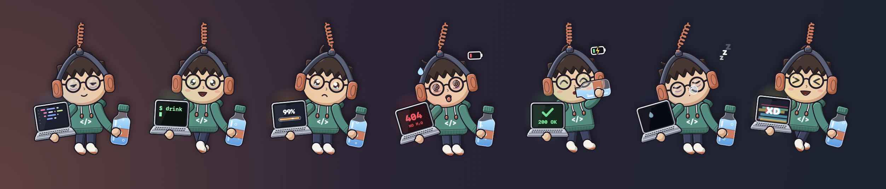
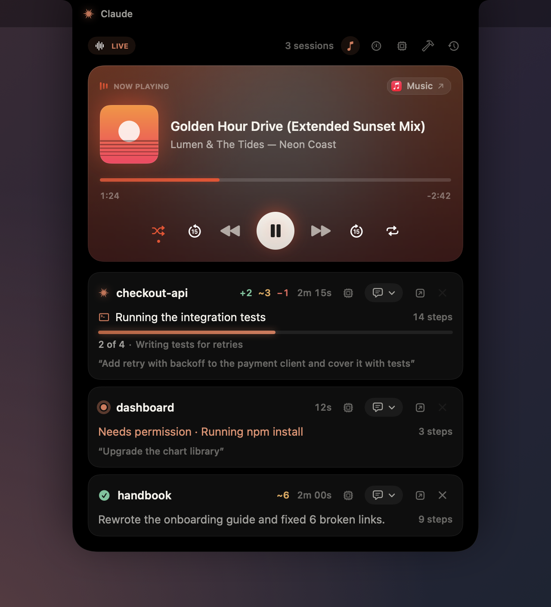

<div align="center">


# NotchGate

**Answer Claude Code from your MacBook's notch.**
Approve permissions, answer questions, follow every session, watch your plan
limits and send the next prompt without switching back to the terminal.


[](https://notchgate.netlify.app)

**[▶ Try the live demo](https://notchgate.netlify.app)**: see NotchGate in your
browser before you install it.

</div>

---

## Install

```bash
curl -fsSL https://raw.githubusercontent.com/PrajsRamteke/NotchGate/main/install.sh | bash
```

Then **restart any running Claude Code sessions**. That's it: look for the ✦ in
your menu bar.

**Requirements:** macOS 14 or later (Apple silicon or Intel) · Claude Code.

<details>
<summary>Install from a clone instead (builds from source)</summary>

```bash
git clone https://github.com/PrajsRamteke/NotchGate.git
cd NotchGate && ./install.sh
```

Building needs Apple's Command Line Tools (`xcode-select --install`; the
installer offers to open it if missing).

</details>

The installer downloads the ready-built app from the
[latest release](https://github.com/PrajsRamteke/NotchGate/releases/tag/latest)
(a few seconds; if that's unavailable it builds from source instead), puts it in
`/Applications`, connects it to Claude Code (backing up `~/.claude/settings.json`
first), installs a small helper in Cursor / VS Code if you have them, and turns
on launch at login. Running it again simply updates NotchGate.

---

## Features

<table>
  <tr>
    <td width="50%">
      
      <p align="center"><b>Approve permissions</b><br>Allow, deny, always allow, or deny with a note.</p>
    </td>
    <td width="50%">
      
      <p align="center"><b>Review file edits</b><br>See the exact diff before Claude writes it.</p>
    </td>
  </tr>
  <tr>
    <td>
      
      <p align="center"><b>Answer questions</b><br>Pick options or write your own answer.</p>
    </td>
    <td>
      
      <p align="center"><b>Approve plans</b><br>Approve, or send it back with feedback.</p>
    </td>
  </tr>
  <tr>
    <td>
      
      <p align="center"><b>Prompt any project</b><br>Hover the notch, pick a session, type, ⏎. It arrives as a real prompt.</p>
    </td>
    <td>
      
      <p align="center"><b>Know when Claude is done</b><br>Read the summary and send what's next.</p>
    </td>
  </tr>
  <tr>
    <td>
      
      <p align="center"><b>Usage and cost at a glance</b><br>5-hour and weekly limits, plus each session's model, context and cost.</p>
    </td>
    <td>
      
      <p align="center"><b>Tool activity and Resume</b><br>Which tools Claude called, and one click back into a recent session.</p>
    </td>
  </tr>
  <tr>
    <td>
      
      <p align="center"><b>Drop images on a project</b><br>Every session lights up as a target; drop on the one you mean.</p>
    </td>
    <td>
      
      <p align="center"><b>Send screenshots with your prompt</b><br>Paste (⌘V) or drag; Claude gets them as file paths.</p>
    </td>
  </tr>
</table>

<p align="center">
  <br>
  <b>Simple settings</b>: choose what appears in the notch; everything else stays in the terminal.
</p>

---

## How it works

- **When Claude needs you**, a card grows out of the notch. Answer it there, or in
  the terminal as usual; whichever you use first wins, and the other clears itself.
- **Hover the notch anytime** to see every Claude session: what it's doing, its
  to-do progress, how long it has been working, your last prompt, and the files it
  added, changed and deleted (`+2 ~3 −1`; hover for line counts).
- **Each session row** has its own buttons: the chip icon opens that session's
  model, context and cost, 💬 opens a prompt box, ↗ brings its terminal to the
  front, and ✕ removes it from the notch. ✕ only works once Claude has stopped,
  so nothing it's doing goes unseen; the session comes back when you prompt it.
- **Send a prompt** from the 💬 dropdown on any session. NotchGate types it into that
  session's terminal and presses Return, so Claude Code receives a genuine prompt.
- **Attach images**: paste one (⌘V) into any notch prompt box, or drag images from
  Finder, a browser or a screenshot onto the notch. It opens with every session
  outlined; drop on the project you want and add a message (or just send). Images
  reach Claude as file paths, the same way a file dragged into the terminal does.
- **Clicks never steal focus** from the app you're working in.

### The whole flow on one page

<p align="center">
  <a href="docs/notchgate-flow.png" target="_blank" title="Open the full-size flow chart">
    
  </a>
  <br>
  <sub>Click the chart to open it full size · <a href="docs/notchgate-flow.svg">SVG version</a></sub>
</p>

### Where you can send prompts from the notch

| Claude Code running in | Supported |
| --- | --- |
| Terminal.app, iTerm2 | ✅ (macOS asks once to allow Automation) |
| tmux (inside any terminal) | ✅ |
| Cursor, VS Code, Windsurf, VSCodium | ✅ via the bundled helper extension |
| WezTerm | ✅ |
| Others (Ghostty, Warp…) | Answering works; sending prompts falls back to Claude's hook |

---

## Widgets

Glanceable cards at the top of the hover panel. Each has a button in the panel's
header to open or close it, and a switch under **✦ → Widgets**.

| Widget | Shows |
| --- | --- |
| **Usage** (gauge) | Your plan's 5-hour and weekly limits, with when each resets. Needs a Pro or Max plan. |
| **Session** (cpu) | Model, context window fill, cost and git branch. With several sessions running, a line for each plus their total cost. |
| **Tool activity** (hammer) | Bash, Edit, Read, Search, Web, Agents and MCP calls as a split bar with counts, and a heat strip of the last hour. Chips switch between all sessions and one. |
| **Resume** (clock) | Recent sessions that aren't running, each one click from `claude --resume` in a new Terminal window, plus **New session** in a recent project or any folder. |

Usage and Session read Claude Code's status line through a small relay; your
own status line keeps showing exactly as before.

---

## Notch Voice

<p align="center">
  
</p>

Dictate into any app: hold a key, say what you want, let go. Your words are typed
where the cursor is: Claude Code's prompt, a browser's search box, Slack, a commit
message.

- **Turn it on** under **✦ → Notch Voice** (it's off by default). macOS asks for the
  **Microphone** and **Accessibility** (so NotchGate can notice the key in other apps
  and type for you); anything still missing shows there with an **Allow** button.
- **Hold to talk**: Right ⌥ by default. Click the keycap and press the key, or two keys,
  you'd rather use (⌃ ⌥ ⇧ ⌘ fn; left and right count separately). A quick ⌥← or ⌥-click
  is never mistaken for dictation, and pressing any other key while talking throws the
  recording away.
- **The pill** at the bottom of the screen shows a live waveform while you talk, then
  **Inserted**: the words are typed straight into the focused field. Only in a password
  field (or without Accessibility) do they go on the clipboard instead, for ⌘V. Whatever
  you had copied is put back after typing.
- **Speech model**: pick who turns your speech into text. Every choice runs on your Mac,
  with no account and no API key. They're listed smallest download first; rest the
  pointer on one to see who it suits:
  - **Apple** (built in): Apple's newest on-device speech model (macOS 26 and later;
    macOS 14–15 use the older recognizer). Pick the **Language** that matches your
    accent, e.g. English (India); **Automatic** follows your Mac's region.
  - **[Whistle](https://huggingface.co/Cactus-Compute/whistle)** by Cactus Compute (17 MB,
    Apache 2.0): English, German, French, Spanish, Italian, Dutch and Polish, with the
    language detected by itself or picked under **Language**.
  - **[Shruti](https://huggingface.co/udgamlabs/Shruti)** by Udgam Labs (30 MB, Apache 2.0):
    Hindi, English and Hinglish. Hindi is written in Devanagari and English words stay in
    English (“मेरा order कब आएगा”). It's Whistle retrained on Indian speech; pick
    **English only** under **Language** for speech that's all English.

  Whistle and Shruti run on the CPU with Cactus's needle engine, which downloads with
  them (Apple silicon).
  Press **↓** beside a model to download it from Hugging Face; every file is checked
  against its published SHA-256, and when it's done NotchGate switches to it. Its own
  text is typed then, with no Apple step. The 🗑 button removes it again. Models live
  in `~/Library/Application Support/NotchGate/Speech Models`.
- **Live words**: your words appear in the pill as you speak. When you let go, a more
  accurate pass of the same recording is typed (Whistle types when you let go, without
  live words).

## Settings

Open the ✦ menu. Every section folds open or closed.

| Show in notch | Default |
| --- | --- |
| Permissions (commands, web, MCP tools) | **On** |
| File edits · Questions · Plan approvals · Reply when done | Off (handled in the terminal) |

Whenever Claude is blocked on you, the notch opens: a type switched off shows an alert pointing to
the terminal instead of its card, and the alert stays until you answer there.

Also available: **Widgets** (see above), **Auto-allow permissions** (risky commands like `rm -rf`, `sudo`
and `git push --force` still ask), **Claude's questions** (Notch / Terminal /
Don't ask), live activity on hover, sounds and launch at login. Under **Behavior → Sounds**, pick the
sound for **Claude needs you** and **Claude finished** from macOS's built-in sounds (or None), and press
**▶** to listen; turn **Sounds** off for silence. While a Claude session is working, the closed notch
shows a moving waveform on its right, so you can tell it's still running without
opening it; turn it off with **Behavior → Live badge while closed**.

### Extras

Optional notch features unrelated to Claude. Turn them on or off under **✦ → Extras**.

<p align="center">
  
</p>

- **Water reminder** (on by default): every 15 minutes (adjustable from 5 minutes to 4 hours) a little bot
  drops out of the notch on a rope, holding a bottle. Hover it for **Drank it** or
  **Snooze**; poke it and it giggles. It gets more insistent the longer you
  ignore it, waits while you're away from the Mac, and counts glasses toward a
  daily goal (8 glasses by default). Snooze for 5, 10, 15 or 30 minutes.
- **Pick your buddy**: the robot (clipped to its rope by the ring on its
  antenna), **Spidey** (who hangs upside down from a web tied round his ankle
  and rolls his mask up to drink), **Batman** (who lowers himself on his
  grapnel line, cape and all), the **Dev** (who dangles from the notch by
  his coiled headphone cable, laptop in hand; his screen types code, sticks at
  99% when he's pleading, shows a 404 when he's parched, glitches when you poke
  him and turns `200 OK` when you drink), or **Random** for a different one on each
  reminder. Set it under **Extras → Buddy**, and press **▶** on the Water
  reminder row to watch your buddy drop in right away (a preview doesn't count
  a glass or move the next reminder).

<p align="center">
  
</p>

<p align="center">
  
</p>

<p align="center">
  
</p>

<p align="center">
  
</p>

<p align="center">
  
</p>

<p align="center">
  
</p>

<p align="center">
  
</p>

- **Now playing** (off by default): whatever's playing on your Mac (Music,
  Spotify, Podcasts, or a YouTube tab in Chrome or Safari) gets a card at the top of
  the hover panel. It shows the artwork, a title that scrolls when it's too long, and
  a progress bar you can drag to seek. Below that are shuffle, ±15 s, previous,
  play/pause and next, repeat. Buttons the player doesn't
  support are dimmed or hidden. The card takes its colors from the artwork. Click the artwork
  or the app chip to jump to the player. While music plays, the closed notch shows
  the artwork and a live equalizer beside the camera (turn this off with **Show while
  closed**). macOS only shares "now playing" with Apple-signed programs, so NotchGate
  reads it through a small helper loaded into the system's `/usr/bin/perl`. The
  helper quits with the app.

<p align="center">
  
</p>

### Keyboard shortcuts (while a request is waiting)

| Shortcut | Action |
| --- | --- |
| `⌃⌥⏎` | Allow / approve |
| `⌃⌥⌫` | Deny / reject |
| `⌃⌥Space` | Show or hide the card |

---

## Updating

NotchGate checks GitHub for updates. When one is available, the ✦ icon gets a
dot and the menu shows **Update available**. Click **Update**: it downloads the new
build and relaunches itself in a few seconds. You can also re-run the install command.

Every push to `main` is built by [`.github/workflows/release.yml`](.github/workflows/release.yml)
into a universal `NotchGate.zip` on the rolling `latest` release; the app only
offers an update once that build is published.

## Uninstall

```bash
curl -fsSL https://raw.githubusercontent.com/PrajsRamteke/NotchGate/main/install.sh | bash -s -- --uninstall
```

This removes the app, its Claude Code hooks, the status line relay (your own
status line is put back) and the login item.

## Privacy

Everything stays on your Mac. NotchGate talks to Claude Code through a private
local socket that only your user can access, and contacts the network only to
check GitHub for updates (and Hugging Face, when you download a speech model).

Notch Voice recognizes speech on your Mac, so your audio never leaves it (macOS
downloads its speech model from Apple once; an open-source model you pick downloads
once from Hugging Face). The transcribed text is only ever typed where your cursor is.

## Troubleshooting

<details>
<summary>Nothing appears in the notch</summary>

Restart your Claude Code sessions after installing (hooks load when a session
starts), and make sure the folder is trusted in Claude Code. Check that
**Show in notch → Permissions** is on.
</details>

<details>
<summary>"The NotchGate helper isn't active in Cursor / VS Code"</summary>

Open the ✦ menu → **Claude Code** → **Install** next to the editor helper, then
reload the editor window once (Command Palette → *Reload Window*).
</details>

<details>
<summary>"macOS blocked NotchGate from controlling Terminal / iTerm"</summary>

Allow it in **System Settings → Privacy & Security → Automation → NotchGate**.
</details>

<details>
<summary>Notch Voice doesn't start or type anything</summary>

Open **✦ → Notch Voice**: it lists any permission still missing. If Accessibility is
already on for NotchGate but still shows as missing (macOS can forget it after an
update), remove NotchGate from **System Settings → Privacy & Security → Accessibility**
with **−** and add it again. To test speech recognition on its own, run
`/Applications/NotchGate.app/Contents/MacOS/NotchGate --transcribe recording.m4a`
(add `--model whistle` or `--model shruti` to try a downloaded model).
</details>

<details>
<summary>An update failed</summary>

Use **Show log** in the menu (`~/Library/Logs/NotchGate/update.log`), or run the
install command again.
</details>

---

## Build from source

```bash
make test   # run the test suite
make run    # run from source as "NotchGate Dev.app" (Ctrl-C quits)
make app    # build dist/NotchGate.app
```

`make run` signs the dev app with a local "NotchGate Dev" identity, created once in its
own keychain, so macOS keeps its Accessibility and microphone permission across
rebuilds. `Scripts/dev-identity.sh --remove` deletes it.

<sub>NotchGate is an independent project and is not affiliated with Anthropic.</sub>
