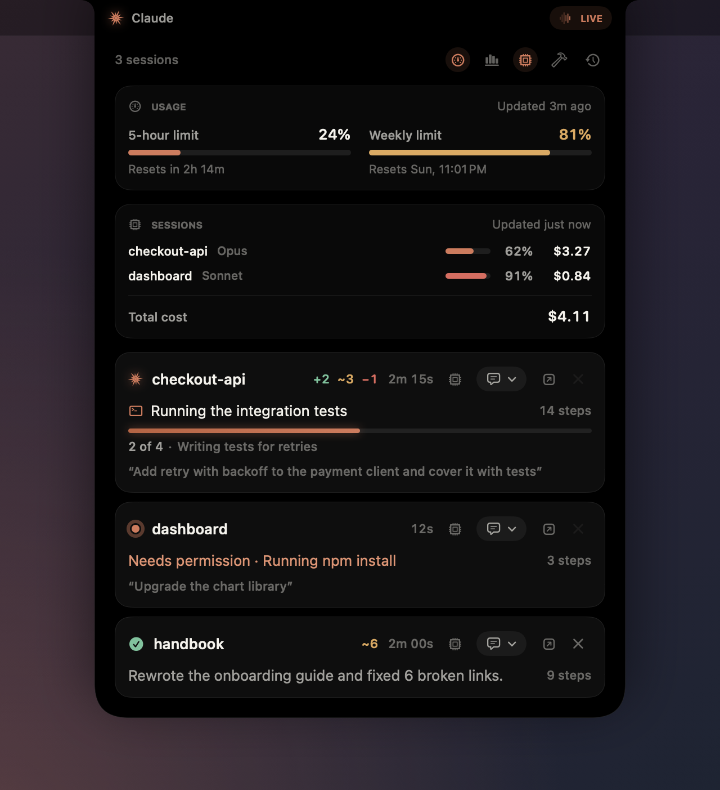
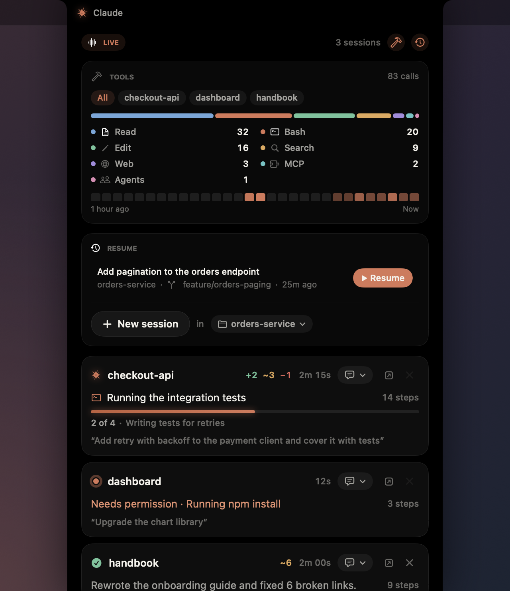
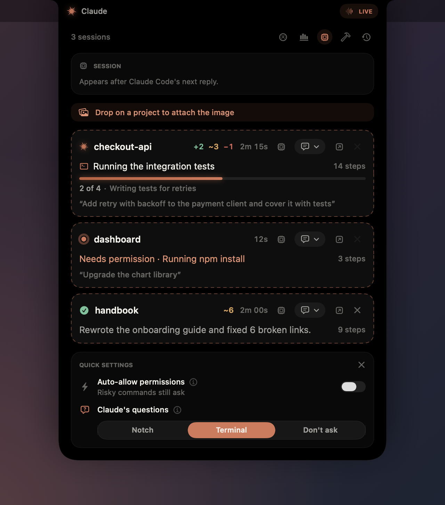
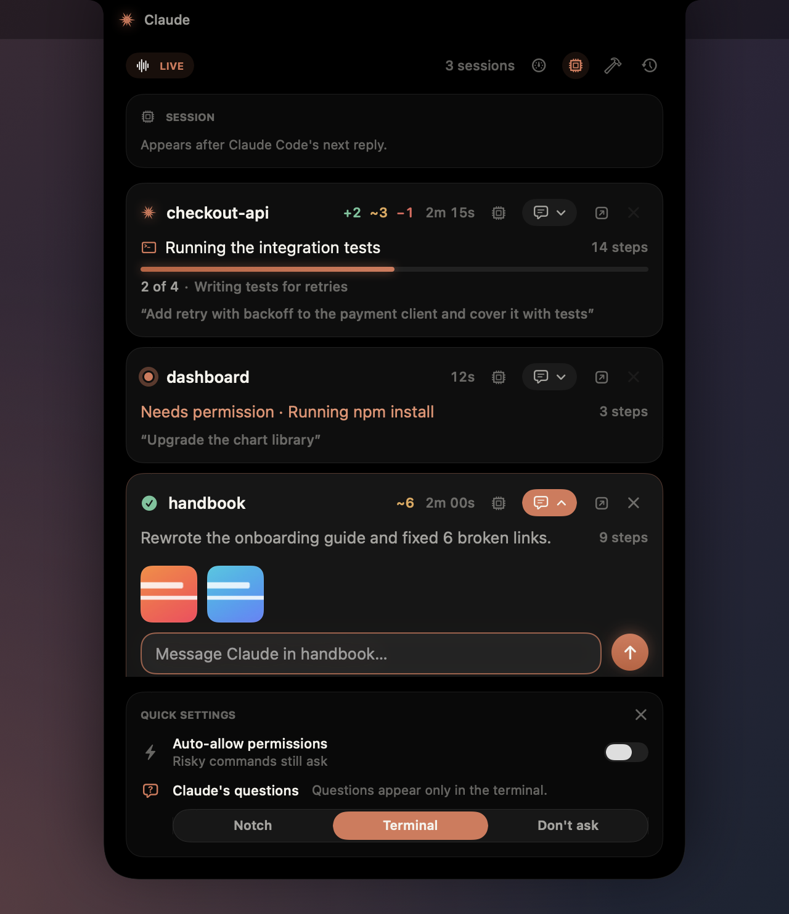
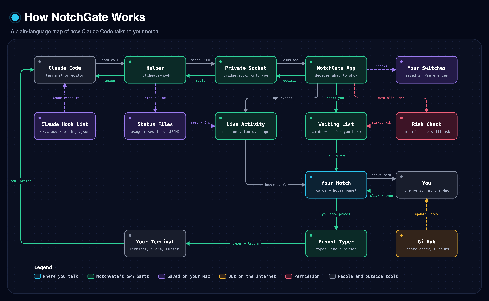
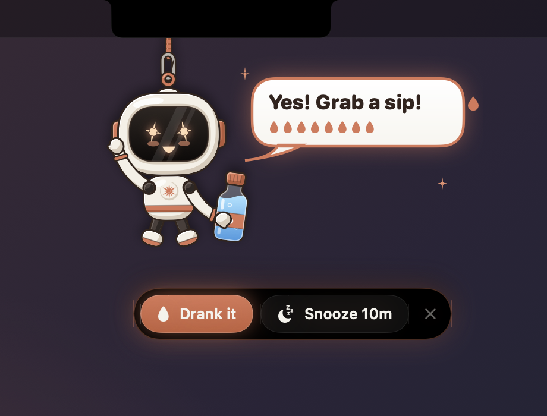
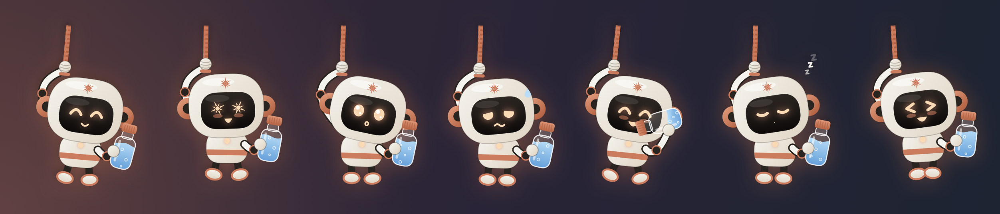

<div align="center">



# NotchGate

**Answer Claude Code from your MacBook's notch.**
Approve permissions, answer questions, follow every session, watch your plan
limits and send the next prompt without switching back to the terminal.


</div>

---

## Install

```bash
curl -fsSL https://raw.githubusercontent.com/PrajsRamteke/NotchGate/main/install.sh | bash
```

Then **restart any running Claude Code sessions**. That's it: look for the ✦ in
your menu bar.

**Requirements:** macOS 14 or later (Apple silicon or Intel) · Claude Code.

<details>
<summary>Install from a clone instead (builds from source)</summary>

```bash
git clone https://github.com/PrajsRamteke/NotchGate.git
cd NotchGate && ./install.sh
```

Building needs Apple's Command Line Tools (`xcode-select --install`; the
installer offers to open it if missing).

</details>

The installer downloads the ready-built app from the
[latest release](https://github.com/PrajsRamteke/NotchGate/releases/tag/latest)
(a few seconds; if that's unavailable it builds from source instead), puts it in
`/Applications`, connects it to Claude Code (backing up `~/.claude/settings.json`
first), installs a small helper in Cursor / VS Code if you have them, and turns
on launch at login. Running it again simply updates NotchGate.

---

## Features

<table>
  <tr>
    <td width="50%">
      
      <p align="center"><b>Approve permissions</b><br>Allow, deny, always allow, or deny with a note.</p>
    </td>
    <td width="50%">
      
      <p align="center"><b>Review file edits</b><br>See the exact diff before Claude writes it.</p>
    </td>
  </tr>
  <tr>
    <td>
      
      <p align="center"><b>Answer questions</b><br>Pick options or write your own answer.</p>
    </td>
    <td>
      
      <p align="center"><b>Approve plans</b><br>Approve, or send it back with feedback.</p>
    </td>
  </tr>
  <tr>
    <td>
      
      <p align="center"><b>Prompt any project</b><br>Hover the notch, pick a session, type, ⏎. It arrives as a real prompt.</p>
    </td>
    <td>
      
      <p align="center"><b>Know when Claude is done</b><br>Read the summary and send what's next.</p>
    </td>
  </tr>
  <tr>
    <td>
      
      <p align="center"><b>Usage and cost at a glance</b><br>5-hour and weekly limits, plus each session's model, context and cost.</p>
    </td>
    <td>
      
      <p align="center"><b>Tool activity and Resume</b><br>Which tools Claude called, and one click back into a recent session.</p>
    </td>
  </tr>
  <tr>
    <td>
      
      <p align="center"><b>Drop images on a project</b><br>Every session lights up as a target; drop on the one you mean.</p>
    </td>
    <td>
      
      <p align="center"><b>Send screenshots with your prompt</b><br>Paste (⌘V) or drag; Claude gets them as file paths.</p>
    </td>
  </tr>
</table>

<p align="center">
  <br>
  <b>Simple settings</b>: choose what appears in the notch; everything else stays in the terminal.
</p>

---

## How it works

- **When Claude needs you**, a card grows out of the notch. Answer it there, or in
  the terminal as usual; whichever you use first wins, and the other clears itself.
- **Hover the notch anytime** to see every Claude session: what it's doing, its
  to-do progress, how long it has been working, your last prompt, and the files it
  added, changed and deleted (`+2 ~3 −1`; hover for line counts).
- **Each session row** has its own buttons: the chip icon opens that session's
  model, context and cost, 💬 opens a prompt box, ↗ brings its terminal to the
  front, and ✕ removes it from the notch. ✕ only works once Claude has stopped,
  so nothing it's doing goes unseen; the session comes back when you prompt it.
- **Send a prompt** from the 💬 dropdown on any session. NotchGate types it into that
  session's terminal and presses Return, so Claude Code receives a genuine prompt.
- **Attach images**: paste one (⌘V) into any notch prompt box, or drag images from
  Finder, a browser or a screenshot onto the notch. It opens with every session
  outlined; drop on the project you want and add a message (or just send). Images
  reach Claude as file paths, the same way a file dragged into the terminal does.
- **Clicks never steal focus** from the app you're working in.

### The whole flow on one page

<p align="center">
  <a href="docs/notchgate-flow.png" target="_blank" title="Open the full-size flow chart">
    
  </a>
  <br>
  <sub>Click the chart to open it full size · <a href="docs/notchgate-flow.svg">SVG version</a></sub>
</p>

### Where you can send prompts from the notch

| Claude Code running in | Supported |
| --- | --- |
| Terminal.app, iTerm2 | ✅ (macOS asks once to allow Automation) |
| tmux (inside any terminal) | ✅ |
| Cursor, VS Code, Windsurf, VSCodium | ✅ via the bundled helper extension |
| WezTerm | ✅ |
| Others (Ghostty, Warp…) | Answering works; sending prompts falls back to Claude's hook |

---

## Widgets

Glanceable cards at the top of the hover panel. Each has a button in the panel's
header to open or close it, and a switch under **✦ → Widgets**.

| Widget | Shows |
| --- | --- |
| **Usage** (gauge) | Your plan's 5-hour and weekly limits, with when each resets. Needs a Pro or Max plan. |
| **Session** (cpu) | Model, context window fill, cost and git branch. With several sessions running, a line for each plus their total cost. |
| **Tool activity** (hammer) | Bash, Edit, Read, Search, Web, Agents and MCP calls as a split bar with counts, and a heat strip of the last hour. Chips switch between all sessions and one. |
| **Resume** (clock) | Recent sessions that aren't running, each one click from `claude --resume` in a new Terminal window, plus **New session** in a recent project or any folder. |

Usage and Session read Claude Code's status line through a small relay; your
own status line keeps showing exactly as before.

---

## Settings

Open the ✦ menu. Every section folds open or closed.

| Show in notch | Default |
| --- | --- |
| Permissions (commands, web, MCP tools) | **On** |
| File edits · Questions · Plan approvals · Reply when done | Off (handled in the terminal) |

Whenever Claude is blocked on you, the notch opens: a type switched off shows an alert pointing to
the terminal instead of its card, and the alert stays until you answer there.

Also available: **Widgets** (see above), **Auto-allow permissions** (risky commands like `rm -rf`, `sudo`
and `git push --force` still ask), **Claude's questions** (Notch / Terminal /
Don't ask), live activity on hover, sounds and launch at login.

### Extras

Optional notch features unrelated to Claude. Turn them on or off under **✦ → Extras**.

<p align="center">
  
</p>

- **Water reminder** (on by default): every 15 minutes (adjustable from 5 minutes to 4 hours) a little bot
  drops out of the notch on a rope, holding a bottle. Hover it for **Drank it** or
  **Snooze**; poke it and it giggles. It gets more insistent the longer you
  ignore it, waits while you're away from the Mac, and counts glasses toward a
  daily goal (8 glasses by default). Snooze for 5, 10, 15 or 30 minutes.

<p align="center">
  
</p>

### Keyboard shortcuts (while a request is waiting)

| Shortcut | Action |
| --- | --- |
| `⌃⌥⏎` | Allow / approve |
| `⌃⌥⌫` | Deny / reject |
| `⌃⌥Space` | Show or hide the card |

---

## Updating

NotchGate checks GitHub for updates. When one is available, the ✦ icon gets a
dot and the menu shows **Update available**. Click **Update**: it downloads the new
build and relaunches itself in a few seconds. You can also re-run the install command.

Every push to `main` is built by [`.github/workflows/release.yml`](.github/workflows/release.yml)
into a universal `NotchGate.zip` on the rolling `latest` release; the app only
offers an update once that build is published.

## Uninstall

```bash
curl -fsSL https://raw.githubusercontent.com/PrajsRamteke/NotchGate/main/install.sh | bash -s -- --uninstall
```

This removes the app, its Claude Code hooks, the status line relay (your own
status line is put back) and the login item.

## Privacy

Everything stays on your Mac. NotchGate talks to Claude Code through a private
local socket that only your user can access, and contacts the network only to
check GitHub for updates.

## Troubleshooting

<details>
<summary>Nothing appears in the notch</summary>

Restart your Claude Code sessions after installing (hooks load when a session
starts), and make sure the folder is trusted in Claude Code. Check that
**Show in notch → Permissions** is on.
</details>

<details>
<summary>"The NotchGate helper isn't active in Cursor / VS Code"</summary>

Open the ✦ menu → **Claude Code** → **Install** next to the editor helper, then
reload the editor window once (Command Palette → *Reload Window*).
</details>

<details>
<summary>"macOS blocked NotchGate from controlling Terminal / iTerm"</summary>

Allow it in **System Settings → Privacy & Security → Automation → NotchGate**.
</details>

<details>
<summary>An update failed</summary>

Use **Show log** in the menu (`~/Library/Logs/NotchGate/update.log`), or run the
install command again.
</details>

---

## Build from source

```bash
make test   # run the test suite
make run    # run from source
make app    # build dist/NotchGate.app
```

<sub>NotchGate is an independent project and is not affiliated with Anthropic.</sub>
