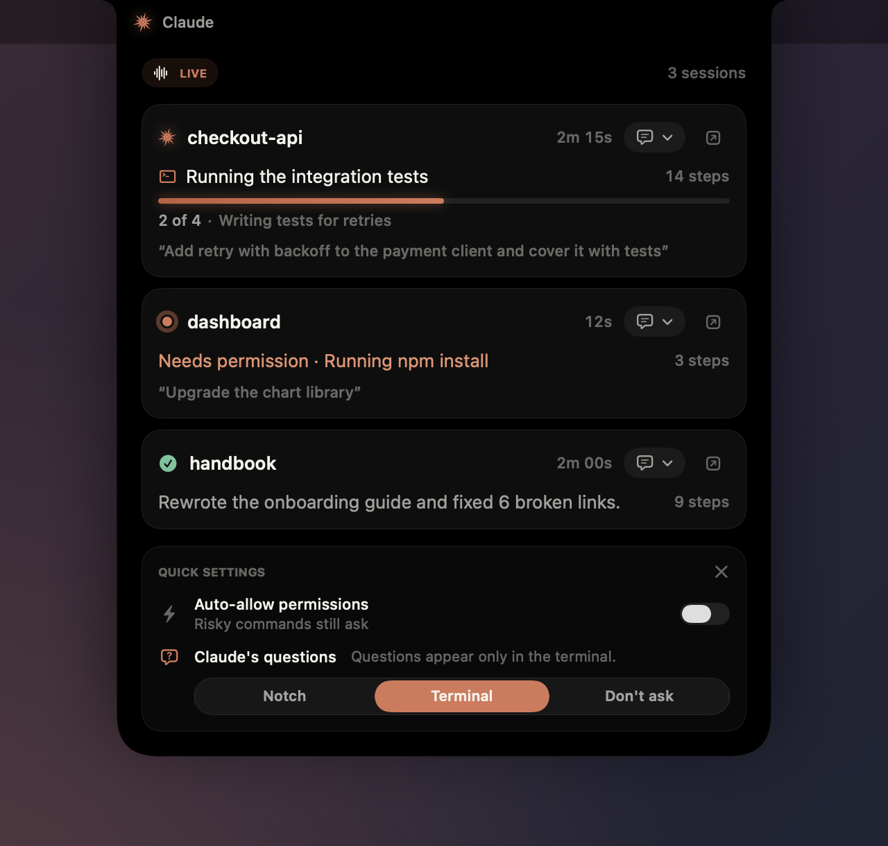
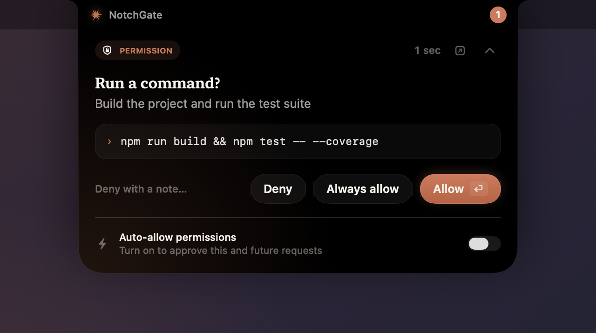
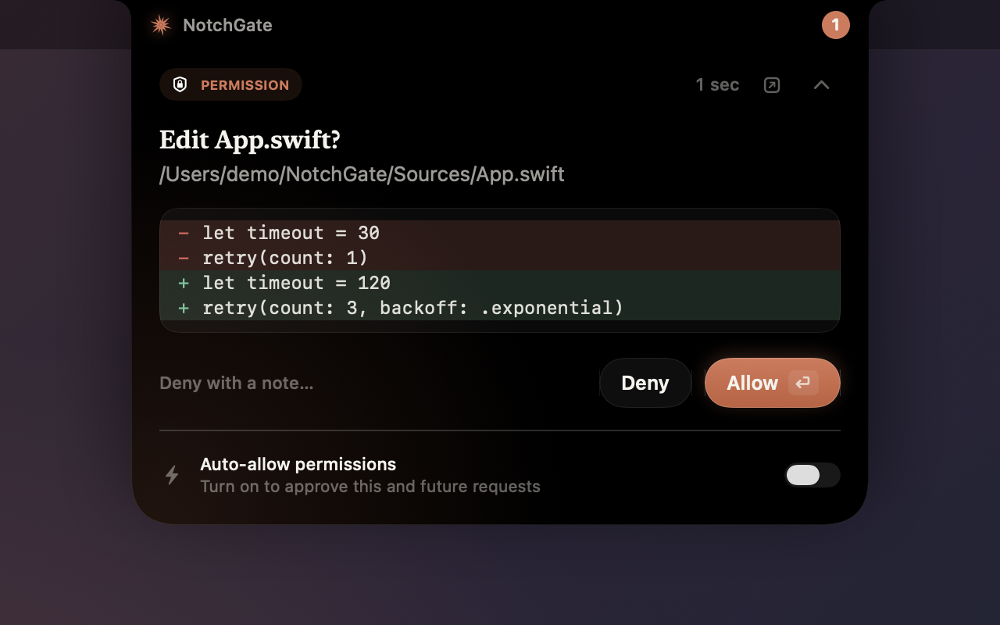
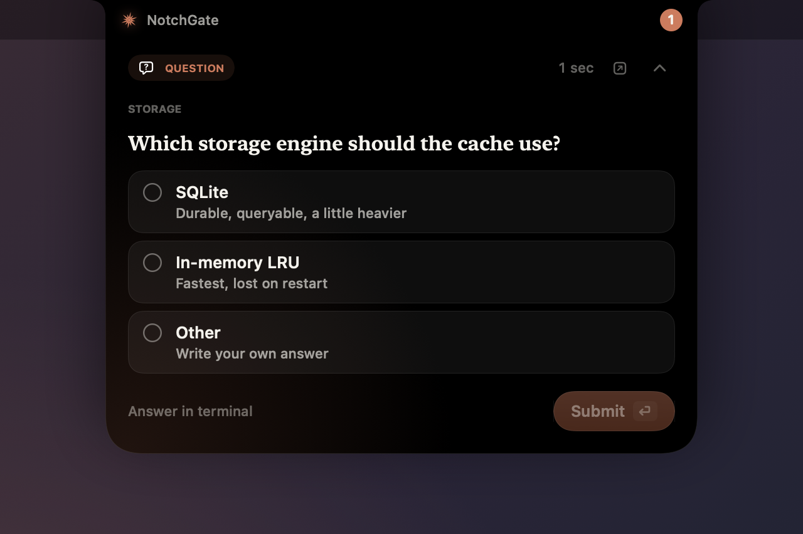
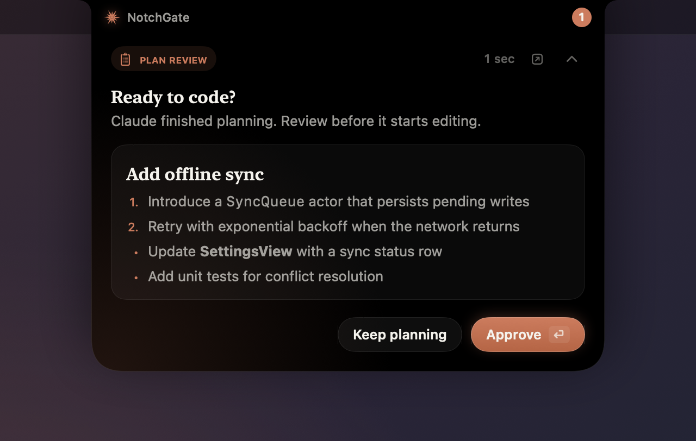
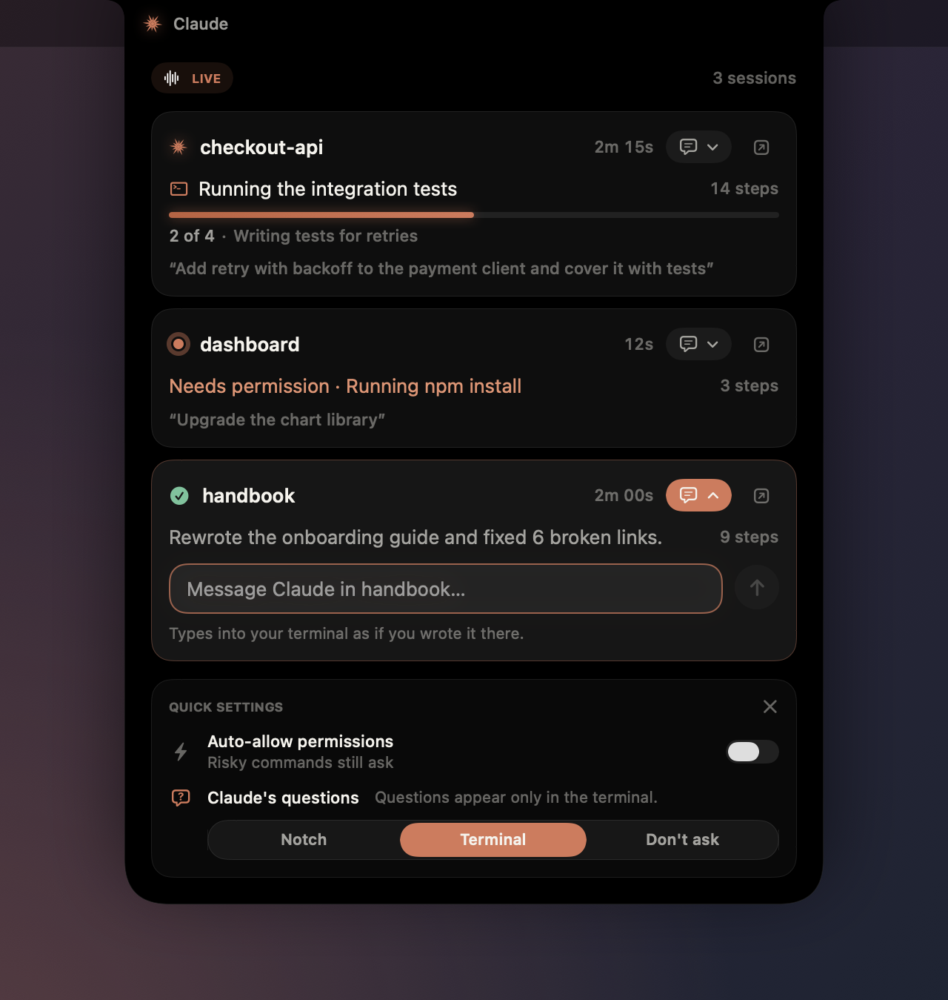
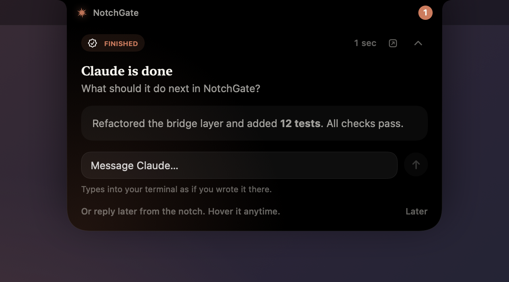
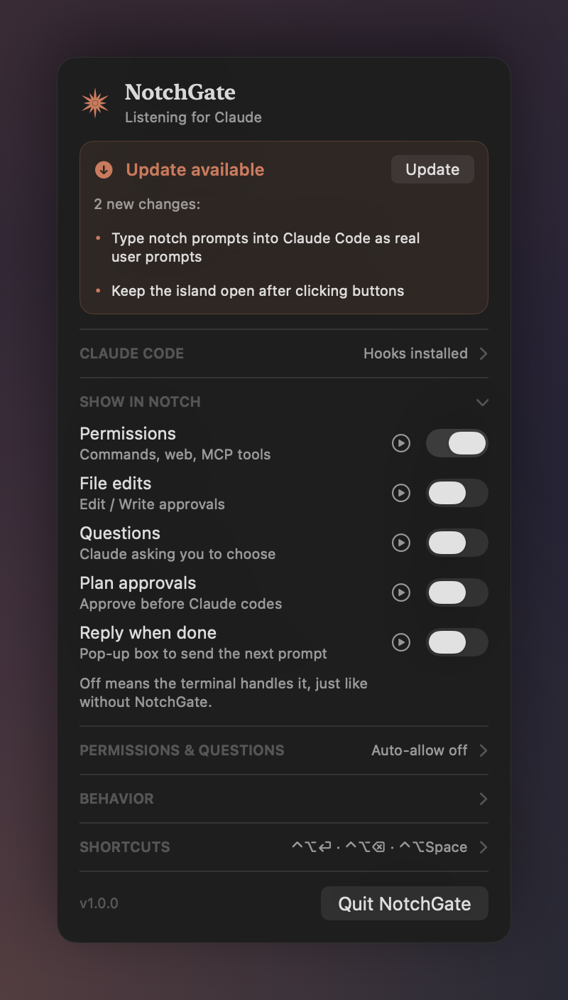

<div align="center">



# NotchGate

**Answer Claude Code from your MacBook's notch.**
Approve permissions, answer questions, follow progress and send the next prompt
without switching back to the terminal.


</div>

---

## Install

```bash
curl -fsSL https://raw.githubusercontent.com/PrajsRamteke/NotchGate/main/install.sh | bash
```

Then **restart any running Claude Code sessions**. That's it: look for the ✦ in
your menu bar.

**Requirements:** macOS 14 or later · Claude Code · Apple's Command Line Tools
(`xcode-select --install`, the installer offers to open it if missing).

<details>
<summary>Install from a clone instead</summary>

```bash
git clone https://github.com/PrajsRamteke/NotchGate.git
cd NotchGate && ./install.sh
```

</details>

The installer builds the app, puts it in `/Applications`, connects it to Claude
Code (backing up `~/.claude/settings.json` first), installs a small helper in
Cursor / VS Code if you have them, and turns on launch at login. Running it
again simply updates NotchGate.

---

## Features

<table>
  <tr>
    <td width="50%">
      
      <p align="center"><b>Approve permissions</b><br>Allow, deny, always allow, or deny with a note.</p>
    </td>
    <td width="50%">
      
      <p align="center"><b>Review file edits</b><br>See the exact diff before Claude writes it.</p>
    </td>
  </tr>
  <tr>
    <td>
      
      <p align="center"><b>Answer questions</b><br>Pick options or write your own answer.</p>
    </td>
    <td>
      
      <p align="center"><b>Approve plans</b><br>Approve, or send it back with feedback.</p>
    </td>
  </tr>
  <tr>
    <td>
      
      <p align="center"><b>Prompt any project</b><br>Hover the notch, pick a session, type, ⏎. It arrives as a real prompt.</p>
    </td>
    <td>
      
      <p align="center"><b>Know when Claude is done</b><br>Read the summary and send what's next.</p>
    </td>
  </tr>
</table>

<p align="center">
  <br>
  <b>Simple settings</b>: choose what appears in the notch; everything else stays in the terminal.
</p>

---

## How it works

- **When Claude needs you**, a card grows out of the notch. Answer it there, or in
  the terminal as usual; whichever you use first wins, and the other clears itself.
- **Hover the notch anytime** to see every Claude session: what it's doing, its
  to-do progress, how long it has been working, and your last prompt.
- **Send a prompt** from the 💬 dropdown on any session. NotchGate types it into that
  session's terminal and presses Return, so Claude Code receives a genuine prompt.
- **Clicks never steal focus** from the app you're working in.

### Where you can send prompts from the notch

| Claude Code running in | Supported |
| --- | --- |
| Terminal.app, iTerm2 | ✅ (macOS asks once to allow Automation) |
| tmux (inside any terminal) | ✅ |
| Cursor, VS Code, Windsurf, VSCodium | ✅ via the bundled helper extension |
| WezTerm | ✅ |
| Others (Ghostty, Warp…) | Answering works; sending prompts falls back to Claude's hook |

---

## Settings

Open the ✦ menu. Every section folds open or closed.

| Show in notch | Default |
| --- | --- |
| Permissions (commands, web, MCP tools) | **On** |
| File edits · Questions · Plan approvals · Reply when done | Off (handled in the terminal) |

Also available: **Auto-allow permissions** (risky commands like `rm -rf`, `sudo`
and `git push --force` still ask), **Claude's questions** (Notch / Terminal /
Don't ask), live activity on hover, sounds and launch at login.

### Keyboard shortcuts (while a request is waiting)

| Shortcut | Action |
| --- | --- |
| `⌃⌥⏎` | Allow / approve |
| `⌃⌥⌫` | Deny / reject |
| `⌃⌥Space` | Show or hide the card |

---

## Updating

NotchGate checks GitHub for updates. When one is available, the ✦ icon gets a
dot and the menu shows **Update available**. Click **Update**: it rebuilds in the
background and relaunches itself. You can also re-run the install command.

## Uninstall

```bash
curl -fsSL https://raw.githubusercontent.com/PrajsRamteke/NotchGate/main/install.sh | bash -s -- --uninstall
```

This removes the app, its Claude Code hooks and the login item.

## Privacy

Everything stays on your Mac. NotchGate talks to Claude Code through a private
local socket that only your user can access, and contacts the network only to
check GitHub for updates.

## Troubleshooting

<details>
<summary>Nothing appears in the notch</summary>

Restart your Claude Code sessions after installing (hooks load when a session
starts), and make sure the folder is trusted in Claude Code. Check that
**Show in notch → Permissions** is on.
</details>

<details>
<summary>"The NotchGate helper isn't active in Cursor / VS Code"</summary>

Open the ✦ menu → **Claude Code** → **Install** next to the editor helper, then
reload the editor window once (Command Palette → *Reload Window*).
</details>

<details>
<summary>"macOS blocked NotchGate from controlling Terminal / iTerm"</summary>

Allow it in **System Settings → Privacy & Security → Automation → NotchGate**.
</details>

<details>
<summary>An update failed</summary>

Use **Show log** in the menu (`~/Library/Logs/NotchGate/update.log`), or run the
install command again.
</details>

---

## Build from source

```bash
make test   # run the test suite
make run    # run from source
make app    # build dist/NotchGate.app
```

<sub>NotchGate is an independent project and is not affiliated with Anthropic.</sub>
